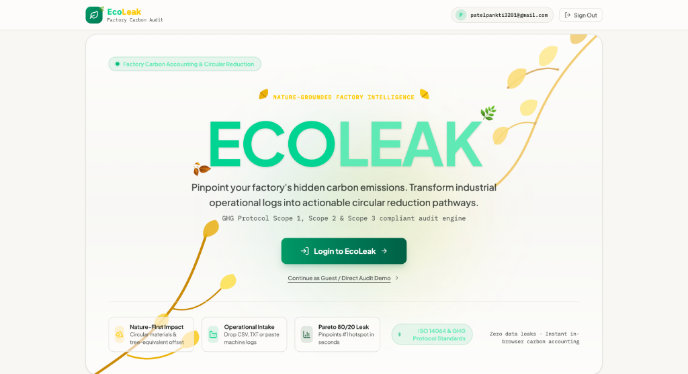
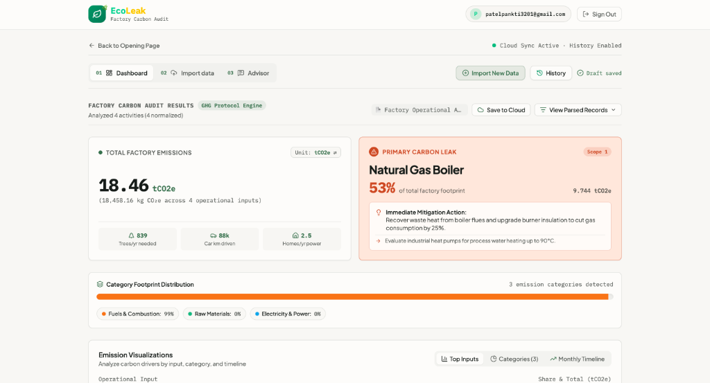
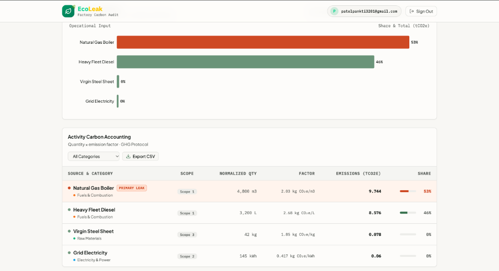
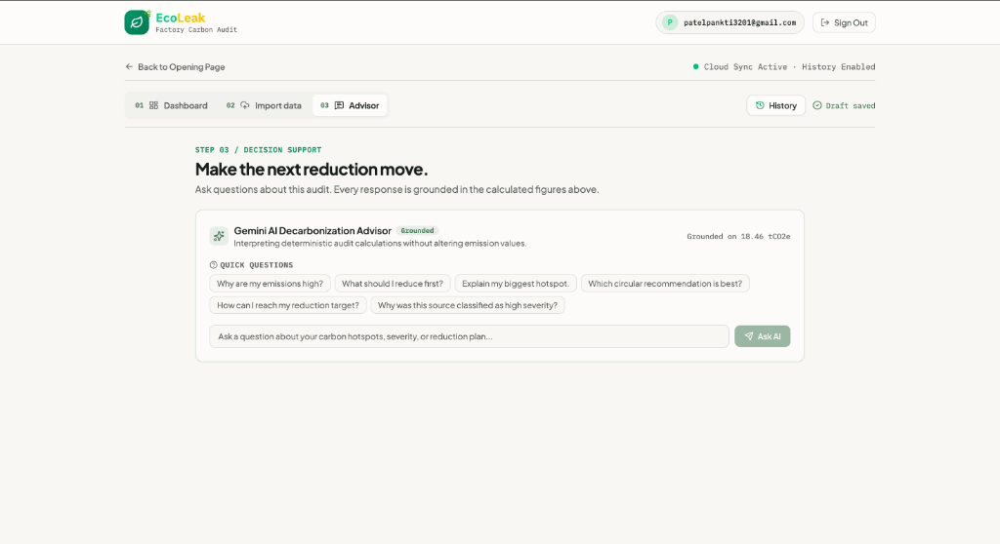

<div align="center">

# 🌿 EcoLeak
### Nature-Grounded Factory Carbon Intelligence & Circular Reduction Engine

[](https://ghgprotocol.org/)
[](https://www.iso.org/standard/66453.html)
[](https://ai.google.dev/)
[](https://vitejs.dev/)

**Pinpoint your factory's hidden carbon leaks. Transform messy industrial operational logs into actionable circular reduction pathways.**

</div>

---

## 📸 Screenshots & Showcase

### 1. Opening Landing Page
> Clean nature-grounded opening portal featuring bold green branding, organic yellow tree branches and leaves artwork, and seamless single-click access.

<div align="center">
  
</div>

<br/>

### 2. Factory Carbon Audit Dashboard & Primary Leak Detection
> Instant calculations quantifying total factory CO₂e footprint, tree-equivalent offset offsets, car km driven equivalencies, and pinpointing the **#1 Primary Carbon Leak** with immediate mitigation actions.

<div align="center">
  
</div>

<br/>

### 3. Activity Carbon Accounting & Pareto 80/20 Breakdown
> Granular Scope 1, Scope 2, and Scope 3 itemization with normalized quantities, standard DEFRA/EPA emission factors, and Pareto distribution visualizations.

<div align="center">
  
</div>

<br/>

### 4. Grounded Gemini AI Decarbonization Advisor
> Context-grounded conversational intelligence interpreting exact factory audit figures to deliver factory-specific mitigation guidance and circular alternatives without hallucinations.

<div align="center">
  
</div>

---

## 🚀 Key Features

- **⚡ Zero-Config Factory Intake**:
  - Drag and drop operational logs (`.csv`, `.tsv`, `.txt`) or paste machine records.
  - Automatic detection of materials, electricity, combustion fuels, process heat, and transport.
  - Multi-unit conversion engine (`MWh -> kWh`, `metric tons -> kg`, `gallons -> L`, `ton-miles -> tkm`).

- **🎯 Automated Pareto Carbon Hotspot Isolation**:
  - Highlights the highest-impact emission source (e.g. Natural Gas Boilers, Heavy Fleet Diesel, Virgin Polymers).
  - Supplies circular replacements and immediate operational efficiency measures.

- **💾 Continuous Auditing & Audit History**:
  - **Returning users** are immediately presented with their **Dashboard** containing past factory calculations.
  - **New accounts** directly enter the **Import data** pipeline.
  - **"Import New Data"** allows running subsequent operational periods without losing past calculations.
  - **History Drawer**: Restore and compare any previous factory run with a single click.

- **👤 Frictionless Guest Mode with Auto-Sync**:
  - Immediate trial mode via *"Continue as Guest"*.
  - Drafts are stored locally and automatically migrate to the user's permanent history upon signing up.

---

## 🛠️ Tech Stack

- **Frontend**: React 19, TypeScript, Tailwind CSS, Lucide Icons
- **Charting & Visualizations**: Recharts
- **Backend / Engine**: Express.js + Node.js (Vite SSR integration)
- **Database & Authentication**: Firebase Authentication & Cloud Firestore (with local fallback)
- **AI Intelligence**: Google Gemini API (Strictly grounded on deterministic calculation results)

---

## 🏃 Getting Started Locally

### Prerequisites
- Node.js (v18 or higher)
- npm or bun

### 1. Clone the repository
```bash
git clone https://github.com/panktipatel2007/EcoLeak.git
cd EcoLeak
```

### 2. Install dependencies
```bash
npm install
```

### 3. Environment Setup
Create a `.env.local` or `.env` file in the root folder:
```env
GEMINI_API_KEY=your_gemini_api_key_here
```

### 4. Run Development Server
```bash
npm run dev
```
Open [http://localhost:3000](http://localhost:3000) in your browser.

---

## 📄 License
This project is licensed under the Apache-2.0 License.
